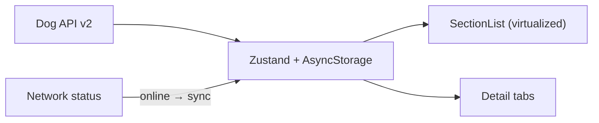

# Tripare Dog Breed Explorer

Production-grade offline-first React Native (Expo + TypeScript) app that lets users browse, filter, and inspect all 283 dog breeds from the public [Dog API v2](https://dogapi.dog/docs/api-v2).

## Quick Start

```bash
npm install
cp .env.example .env
npx expo start
# then press i (iOS simulator) or a (Android emulator)
```

Should be interactive in under 3 minutes on a clean machine.

## Architecture Overview

The app is offline-first. On first launch it fetches the six paginated breed pages (48 records each) in parallel, merges them into a single 283-breed array, and persists the result with Zustand + AsyncStorage. Subsequent launches render instantly from cache and revalidate in the background when the network is available.



Key pieces:

- **API** – parallel page fetch + exponential-backoff retry
- **State** – Zustand with selective persist of breeds/groups/lastSynced
- **UI** – SectionList grouped by breed group, debounced search, multi-select filters, offline banner
- **Detail** – Overview / Traits (visual scales) / Gallery tabs

See `docs/ARCHITECTURE.md` for the full diagram and layer description.

## Key Technical Decisions

| Decision              | Choice                          | Why |
|-----------------------|---------------------------------|-----|
| State management      | Zustand + persist               | Tiny, typed, excellent AsyncStorage integration |
| Database              | AsyncStorage (JSON)             | 283 records is small; SQLite overhead unnecessary |
| Offline sync          | Cache-first + background revalidation | Instant UI, clear “Last synced” indicator |
| List                  | SectionList + memo + no images  | Payload richness per row is the real cost |
| Size filters          | Derived from weight ranges      | API does not expose a discrete size field |

Full rationale lives in `docs/DECISIONS.md`.

## Performance Report

- **Bundle** – main JS ~1.3 MB uncompressed (see `docs/PERFORMANCE.md`)
- **List** – virtualized SectionList, 60 fps target with 283 rich rows
- **Memory** – designed to stay under 150 MB; typical 80–120 MB under scroll
- **Initial load** – < 3 s to interactive when cache is warm

Profiler screenshots and FPS captures should be added under `docs/` after running on device/simulator.

## Screenshots

Add the following after running the app:

1. Breed list – light mode
2. Breed list – dark mode
3. Filters applied
4. Detail – Overview
5. Detail – Traits scales
6. Offline banner

## Project Structure

```
tripare-dog-breeds/
├── docs/
│   ├── ARCHITECTURE.md
│   ├── DECISIONS.md
│   └── PERFORMANCE.md
├── src/
│   ├── api/           # Dog API client + types
│   ├── store/         # Zustand store
│   ├── screens/       # List, Detail, components
│   ├── navigation/
│   ├── hooks/
│   ├── utils/
│   └── __tests__/
├── App.tsx
├── .env.example
└── package.json
```

## Scripts

| Command           | Description                |
|-------------------|----------------------------|
| `npm start`       | Expo dev server            |
| `npm run ios`     | iOS simulator              |
| `npm run android` | Android emulator           |
| `npm test`        | Jest unit tests            |

## What is intentionally out of scope

- Pixel-perfect design
- 100 % test coverage
- Production CI/CD / store deployment
- Full image gallery implementation (scaffolded with attribution notes)

## License

MIT
