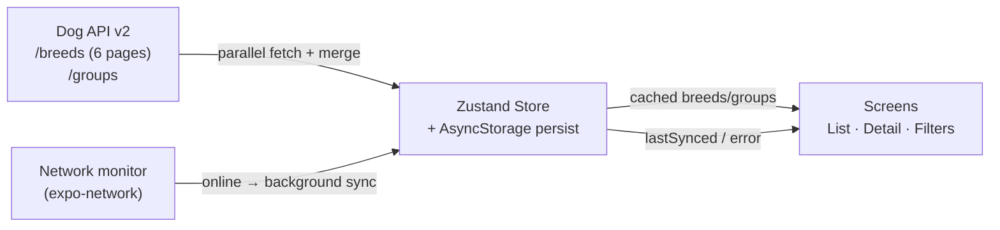

# Architecture – Dog Breed Explorer

## Overview

Offline-first React Native (Expo) app that loads all 283 dog breeds from the public Dog API v2, persists them locally, and provides fast filtered discovery + detail views.

## High-level data flow

## Layers

1. **API layer** (`src/api/`)
   - Parallel fetch of 6 pages (page size 48) → single 283-breed array
   - Exponential-backoff retry helper
   - Single-breed detail refresh

2. **State + Persistence** (`src/store/`)
   - Zustand + `persist` middleware backed by AsyncStorage
   - Normalized flat arrays for breeds and groups
   - `lastSynced` timestamp + error banner state

3. **UI**
   - `SectionList` grouped by breed group (virtualized)
   - Debounced search + multi-select filters
   - Detail screen with Overview / Traits / Gallery tabs
   - Offline banner that always shows data freshness

4. **Navigation**
   - React Navigation native stack, fully typed (`RootStackParamList`)

## Offline strategy

- First launch: fetch → persist → render
- Subsequent launches: render from cache instantly, background revalidation when online
- Network drop: keep showing cached data + amber “Offline” banner
- Partial failure: show whatever is already cached + red error banner

## Image strategy (list vs detail)

- List rows intentionally carry **no images** (or only tiny placeholders) so 283 rich records stay at 60 fps.
- Detail Gallery upgrades to medium/large variants on demand and surfaces author / license / source attribution from the API.
